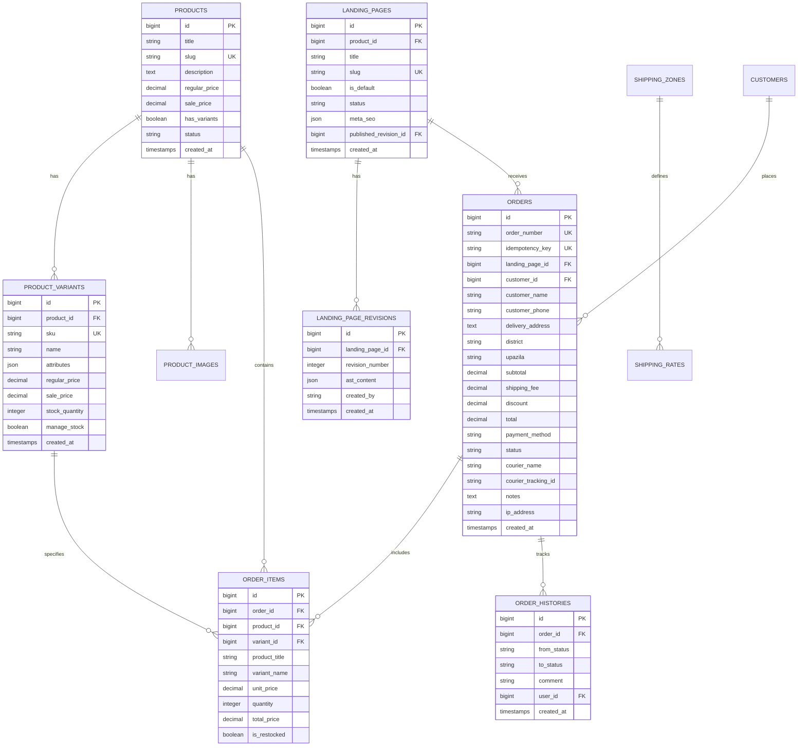

# Technical Architecture: Landing Commerce Starter Kit

## 1. Architectural Philosophy & Strategy

The **Landing Commerce Starter Kit** is engineered as a **Modular Monolith** using **Laravel 13.x (requiring PHP ^8.3 or a compatible newer supported version)** for the backend business logic and **React with TypeScript** via **Inertia.js** for interactive administrative workflows, complemented by high-performance server-rendered frontend landing pages.

```
+-----------------------------------------------------------------------------------+
|                                Client Browser                                     |
|  +---------------------------------------+  +-----------------------------------+ |
|  |       Admin & Page Builder App        |  |     Customer-Facing Landing Page  | |
|  |     (React + TypeScript + Inertia)    |  |   (Zero-JS Blade AST / React)     | |
|  +---------------------------------------+  +-----------------------------------+ |
+------------------------------------------+----------------------------------------+
                                           | HTTP / JSON / Inertia Protocol
+------------------------------------------v----------------------------------------+
|                                Laravel 13.x Core                                  |
|  +-------------------+  +-------------------+  +--------------------------------+ |
|  | Auth & Security   |  | E-Commerce Core   |  | Page Builder Engine            | |
|  | - Session/Sanctum |  | - Catalog/Variants|  | - Allowlisted AST Validator    | |
|  | - 3-Tier RBAC     |  | - lockForUpdate() |  | - Whitelist Style Sanitizer    | |
|  | - Rate Limiting   |  | - Idempotent COD  |  | - Revision Control             | |
|  +-------------------+  +-------------------+  +--------------------------------+ |
|  +-------------------+  +-------------------+  +--------------------------------+ |
|  | Order Management  |  | Bangladesh Hub    |  | Storage & Media Engine         | |
|  | - Status FSM      |  | - Courier Gateway |  | - WebP Optimizer (GD/Imagick)  | |
|  | - Idempotent Restock - SMS Dispatcher    |  | - MIME-Verified Public Disk    | |
|  +-------------------+  +-------------------+  +--------------------------------+ |
+------------------------------------------+----------------------------------------+
                                           | Eloquent ORM / PDO
+------------------------------------------v----------------------------------------+
|                          MySQL 8.0+ / MariaDB 10.6+                               |
|                  (Single-Tenant Isolated Persistent Database)                     |
+-----------------------------------------------------------------------------------+
```

### 1.1 Why Laravel 13 + Inertia.js + React + TypeScript?
1. **Self-Hosted Practicality on Bangladeshi cPanel & VPS:**
   * **Zero Runtime Node.js on Production:** Typical cPanel hosts lack persistent Node.js background daemons or kill them via CloudLinux LVE memory limits. React and Inertia.js production assets must be pre-compiled into static bundles (`public/build/*`) during local development or CI build before deployment. The production environment runs purely on standard PHP 8.3-FPM / LiteSpeed and MySQL without depending on a persistent Node.js process to serve those assets.
   * **Hosting Compatibility Verification:** Do not claim that cPanel, LiteSpeed, or any specific hosting provider supports PHP 8.3+ or required extensions until verified on the target host. Target deployment environments must be checked individually.
   * **Single Domain & Cookie Auth:** Eliminates CORS configurations, OAuth token refresh cycles, and complex SSL orchestration.
2. **Type-Safe Fullstack Engineering:** TypeScript interfaces define server-to-client contracts (`PageProps`, `Product`, `Order`, `BlockAST`), preventing runtime crashes.
3. **Rich Visual Editor:** Building a fluid drag-and-drop page builder with undo/redo, real-time styling, responsive view toggles, and block reordering is best achieved using React's declarative state ecosystem (`@dnd-kit`, `zustand`, `lucide-react`).
4. **Sub-Second Customer Landing Page Loads:**
   * **Public Landing Page Rendering:** Customer-facing landing pages can be rendered directly by a **Server-Side Blade AST Component Renderer** with optional lightweight interactive islands (for variant selection and the COD form), or via Inertia. The Blade AST renderer has zero runtime JS overhead, instant SEO, and is engineered with a performance target of sub-120ms rendering (design target, not guaranteed, subject to host hardware, TTFB, and caching).

---

## 2. Directory Structure & Modular Monolith Layout

```
landing-commerce/
├── app/
│   ├── Modules/
│   │   ├── Catalog/             # Products, Variants, Attributes, Categories
│   │   │   ├── Models/
│   │   │   ├── Actions/         # CreateProductAction, UpdateStockAction
│   │   │   ├── Controllers/
│   │   │   └── Requests/
│   │   ├── PageBuilder/         # AST Validation, Block Registry, Renderers
│   │   │   ├── Blocks/          # HeroBlock, CodCheckoutBlock, TestimonialBlock
│   │   │   ├── Services/        # AstParser, HtmlSanitizer
│   │   │   ├── Models/          # LandingPage, PageRevision
│   │   │   └── Controllers/
│   │   ├── Checkout/            # COD Order Processing, Inventory Locking
│   │   │   ├── Actions/         # ProcessCodOrderAction, ReserveStockAction
│   │   │   ├── Rules/           # BdPhoneRule, ValidDistrictRule
│   │   │   └── Controllers/
│   │   ├── Orders/              # Order Pipeline, Fulfillments, Invoicing
│   │   │   ├── Models/          # Order, OrderItem, OrderHistory
│   │   │   ├── Events/          # OrderPlaced, OrderStatusChanged
│   │   │   └── Listeners/
│   │   ├── BangladeshHub/       # Couriers & SMS Integration
│   │   │   ├── Couriers/        # SteadfastDriver, PathaoDriver, RedXDriver, MockDriver
│   │   │   └── Sms/             # GreenwebDriver, SslWirelessDriver, MockDriver
│   │   └── Media/               # Image optimization, WebP conversion
│   └── Providers/
├── config/
├── database/
│   ├── migrations/
│   └── seeders/
├── resources/
│   ├── js/
│   │   ├── Builder/             # React Visual Page Builder Core
│   │   │   ├── components/      # Canvas, Sidebar, Inspector, BlockTree
│   │   │   ├── blocks/          # Visual components (Hero, COD Form, etc.)
│   │   │   ├── stores/          # Zustand builder state (history, selected block)
│   │   │   └── types/           # AST type definitions
│   │   ├── Admin/               # Orders, Catalog, Settings Dashboard
│   │   ├── Shared/              # UI components (Button, Modal, Input, Badge)
│   │   └── app.tsx              # Inertia setup
│   └── views/
│       ├── app.blade.php        # Inertia base layout for Admin & Builder
│       └── landing/             # Ultra-fast customer view (Blade AST Renderer)
├── routes/
│   ├── web.php                  # Customer landing pages & COD endpoints
│   ├── admin.php                # Authenticated merchant administration
│   └── auth.php
└── tests/
    ├── Feature/
    └── Unit/
```

---

## 3. Database Schema & Data Models

All primary IDs use `BIGINT UNSIGNED`. High-traffic tables (`orders`, `landing_pages`) have indexed composite lookup keys.



### 3.1 Database Strategy: SQLite (Testing) vs. MySQL 8.0+ (Production)
* **Critical Behavioral Difference:**
  * **Pessimistic Row Locking:** SQLite does *not* support `SELECT ... FOR UPDATE` row locks; SQLite locks at the entire database file level. Running concurrency tests against SQLite gives a false sense of security.
  * **Invalidity of Sequential Loops:** Sequential iteration (such as `collect()->map()` or `foreach`) executes requests one after another on a single thread and cannot simulate parallel race conditions.
  * **Test Strategy:** Fast offline unit tests and schema assertions run against SQLite (`:memory:`). High-concurrency race condition tests (such as simultaneous checkout requests competing for the last available item) **must** be executed against a running MySQL 8.4+ instance using a genuine parallel or multi-process HTTP test harness.
  * **Foreign Key Constraints:** SQLite requires `PRAGMA foreign_keys = ON;` on every database connection, whereas MySQL enforces referential integrity natively.

### 3.2 Inventory Concurrency, Duplicate Checkout & Idempotent Restocking

#### A. Concurrency & Inventory Lock
```php
DB::transaction(function () use ($orderData, $items, $idempotencyKey) {
    // 1. Check idempotency to prevent duplicate submissions on network lag
    if (Order::where('idempotency_key', $idempotencyKey)->exists()) {
        return Order::where('idempotency_key', $idempotencyKey)->first();
    }

    // 2. Lock variant rows pessimistically
    foreach ($items as $item) {
        $variant = ProductVariant::where('id', $item['variant_id'])
            ->lockForUpdate()
            ->firstOrFail();

        if ($variant->manage_stock && $variant->stock_quantity < $item['quantity']) {
            throw new InsufficientStockException("Stock exhausted for {$variant->name}");
        }

        if ($variant->manage_stock) {
            $variant->decrement('stock_quantity', $item['quantity']);
        }
    }

    // 3. Create order, order items with is_restocked = false, and history log
});
```

#### B. Anti-Duplicate Checkout Guard
To prevent duplicate orders when impatient customers click "Confirm Order" multiple times on 3G/4G connections:
1. Client generates a unique UUID `idempotency_key` on form mount.
2. The endpoint checks `Cache::lock("checkout:{$phone}:{$idempotencyKey}", 15)->get(...)`.
3. The database enforces a `UNIQUE(idempotency_key)` constraint on the `orders` table.

#### C. Idempotent Stock Replenishment on Cancellation & Webhooks
When an order transitions from `Pending`/`Confirmed` to `Cancelled` or `Returned` (via admin intervention or courier return webhooks):
```php
DB::transaction(function () use ($order, $adminUser, $reason) {
    $order = Order::where('id', $order->id)->lockForUpdate()->firstOrFail();

    foreach ($order->items as $item) {
        // Enforce strict idempotency: never restock twice on repeated cancellations or duplicate webhooks
        if (! $item->is_restocked && $item->variant && $item->variant->manage_stock) {
            $item->variant()->lockForUpdate()->increment('stock_quantity', $item->quantity);
            $item->update(['is_restocked' => true]);
        }
    }

    $order->update(['status' => OrderStatus::CANCELLED]);
    $order->histories()->create([
        'from_status' => $order->getOriginal('status'),
        'to_status' => OrderStatus::CANCELLED,
        'comment' => $reason,
        'user_id' => $adminUser ? $adminUser->id : null,
    ]);
});
```

---

## 4. Visual Page Builder Engine (Schema-Driven AST)

### 4.1 Abstract Syntax Tree (AST) Data Structure
The page layout is saved strictly as a JSON tree. Neither HTML markup nor JavaScript scripts are stored in the database.

```json
{
  "version": 1,
  "settings": {
    "primaryColor": "#16a34a",
    "fontFamily": "Inter",
    "containerMaxWidth": "1200px"
  },
  "blocks": [
    {
      "id": "blk_hero_98a72f",
      "type": "HeroBlock",
      "props": {
        "headline": "Premium Leather Wallet",
        "subheadline": "100% Genuine Leather with Cash on Delivery nationwide",
        "ctaText": "Order Now",
        "ctaTarget": "#cod-checkout",
        "badgeText": "Limited Offer"
      },
      "styles": {
        "backgroundColor": "#f8fafc",
        "paddingTop": "48px",
        "paddingBottom": "48px"
      }
    },
    {
      "id": "blk_cod_34f81c",
      "type": "CodCheckoutBlock",
      "props": {
        "productId": 1,
        "variantSelectionType": "swatches",
        "showQuantity": true,
        "buttonText": "Confirm Order"
      },
      "styles": {
        "borderWidth": "2px",
        "borderColor": "#16a34a"
      }
    }
  ]
}
```

### 4.2 Security, AST Sanitization & Rendering Policy
1. **Server-Side Validation:** When a revision is saved (`POST /admin/landing-pages/{id}/revisions`), Laravel validates every node in the AST using `PageAstValidator`. Never render arbitrary merchant-provided JavaScript or unsanitized raw HTML.
2. **Approved Block Allowlist:** Only registered block types (`HeroBlock`, `ProductSelectorBlock`, `CodCheckoutBlock`, `BenefitsGridBlock`, `ReviewsBlock`, `VideoBlock`, `FaqBlock`, `CountdownTimerBlock`, `StickyBarBlock`) are accepted. Unknown blocks are rejected with HTTP 422.
3. **Strict CSS Whitelist:**
   * **Allowed CSS Properties:** `color`, `background-color`, `padding`, `margin`, `border-radius`, `font-size`, `text-align`, `max-width`, `border-color`, `border-width`.
   * **Prohibited CSS Properties:** `position: fixed` overlays (except standard approved sticky bar blocks), `z-index` manipulation over 50 (prevents clickjacking overlay attacks), `behavior`, `expression`, `url(javascript:...)`, and `@import`.
4. **URL Protocol Whitelist:** Links, image URLs, and button targets must strictly validate against `https:`, `http:`, `tel:`, `mailto:`, or internal anchor `#` hashes. Protocols like `javascript:`, `data:`, and `vbscript:`, along with inline event handlers (`onclick`, `onload`, `onerror`), are stripped or rejected.
5. **Image Upload Security:** Image uploads are restricted to approved raster formats (WebP, JPEG, PNG) by default. Arbitrary SVG uploads are prohibited; if SVG support is introduced in future revisions, require a maintained, security-reviewed sanitizer (`enshrined/svg-sanitize`).
6. **Zero Inline Scripts:** Dynamic behaviors (such as variant switching, total calculation, countdown timer) are executed solely by pre-compiled, tested React/Blade components, never from user-submitted text.

---

## 5. Bangladesh Localization & Courier Pipeline

### 5.1 Geographic & Pricing Engine
* Built-in dataset of all **64 Districts (Zillas)** and **495 Upazilas/Thanas** of Bangladesh.
* Dynamic shipping rate calculator:
  * **Zone A (Inside Dhaka):** Flat rate (e.g., ৳70) - 24-48 hours delivery.
  * **Zone B (Dhaka Suburbs - Savar, Gazipur, Keraniganj, Narayanganj):** Flat rate (e.g., ৳100).
  * **Zone C (Outside Dhaka):** Flat rate (e.g., ৳130) - 48-72 hours delivery.

### 5.2 Courier Gateway Abstraction (Driver Pattern)
```
             +---------------------------+
             |    CourierService (API)   |
             +-------------+-------------+
                           |
       +-------------------+-------------------+
       |                   |                   |
+------v------+     +------v------+     +------v------+
|  Steadfast  |     |   Pathao    |     |    RedX     |
|   Driver    |     |   Driver    |     |   Driver    |
+-------------+     +-------------+     +-------------+
```
Each courier driver implements `CourierDriverInterface`:
* `createOrder(Order $order): CourierBookingResult`
* `trackOrder(string $trackingId): TrackingStatus`
* `cancelOrder(string $trackingId): bool`

### 5.3 Anti-Fraud & Spam Protection
* **IP & Mobile Rate Limiter:** Maximum 3 orders per 15 minutes per IP; maximum 1 order per 5 minutes per phone number.
* **Phone Number Regex Validation:** Must match Bangladesh cellular standards: `^(?:\+88|88)?(01[3-9]\d{8})$`.
* **Blacklist Management:** Block repeat offenders with high return/cancellation history.

---

## 6. Authentication, Authorization & Production Deployment

### 6.1 Authentication & 3-Tier Role-Based Access Control (RBAC)
* **Authentication Core & Rate Limiting:** State-managed cookie sessions via Laravel Breeze/Sanctum with aggressive rate-limiting (e.g. 5 attempts per minute per IP/username) on all authentication endpoints to prevent brute-force attacks.
* **Server-Side Authorization:** Enforce strict policy gates on all mutating administrative endpoints and sensitive backup operations. No administrative or backup operation may rely solely on UI-level hiding.
* **Granular Role Definitions:**
  1. `super_admin`: Unrestricted access across store settings, user accounts, courier API keys, raw audit logs, database backups, and visual page builder.
  2. `store_manager`: Can manage products, categories, stock levels, view/edit landing pages, and process orders. Cannot edit system settings, delete other admin users, or view raw security logs.
  3. `fulfillment_agent`: Restricted exclusively to the Order Management pipeline. Can view customer details, print invoices, and update statuses (`Pending` -> `Confirmed` -> `Handed to Courier`). Cannot alter product prices, delete orders, or access the page builder.

### 6.2 Hosting Architecture & Web Root Isolation
* **Hosting Compatibility Mandate:** Laravel 13 deployment requires PHP 8.3 or a compatible newer supported version. Do not claim or assume that cPanel, LiteSpeed, or any target host supports PHP >= 8.3 or required extensions until verified on that host via preflight checks.
* **Pre-Compiled Production Assets:** All React and Inertia assets must be compiled to static bundles (`npm run build`) before deployment; production must not depend on a persistent Node.js process merely to serve assets.
* **Document Root Isolation:**
  * Placing application code, `.env`, and logs outside the publicly accessible document root is mandatory wherever possible.
  * **Primary Architecture (Recommended):** Deploy application files to a non-public directory (e.g., `~/landing-commerce/`) and symlink `~/public_html` to `~/landing-commerce/public`.
  * **Secondary Rewrite Defense:** Where directory isolation or symlinks are restricted by shared hosting providers, an optimized `.htaccess` rewrites requests to `/public/`. However, this `.htaccess` approach must **never** be treated as an acceptable substitute for placing `.env`, application code, and logs outside the publicly accessible web root wherever possible.
* **Queues & Scheduled Tasks:**
  * *VPS Deployments:* Supervisor manages persistent `php artisan queue:work` worker daemons.
  * *Shared Hosting (cPanel):* Scheduled tasks run via system cron using the host's specific PHP 8.3 CLI binary path (e.g., `* * * * * /usr/local/bin/ea-php83 /home/username/landing-commerce/artisan schedule:run >> /dev/null 2>&1`), processing queued jobs using the database queue driver or synchronous execution fallback.

### 6.3 Database Backup & Resilient Restore Engine
* **Shared Hosting Realities:** Standard cPanel PHP environments frequently disable `proc_open()`, `exec()`, or lack the `mysqldump` binary.
* **Pure-PHP Export Engine:** Generates standard MySQL-compliant dump files directly through PDO without calling external OS binaries or shell commands (`php artisan commerce:backup`).
* **DDL Non-Transactional Recovery Strategy:**
  > [!IMPORTANT]
  > MySQL DDL statements (`CREATE TABLE`, `DROP TABLE`, `ALTER TABLE`) trigger implicit commits and **cannot be rolled back** within a single transaction. If a restore operation encounters an error mid-stream, partial schema modifications persist.
  * **Restore Protocol & Failure Handling:**
    1. Pre-restore SQL syntax and checksum validation.
    2. Automated pre-restore backup snapshot created before executing any drop or create statements.
    3. Transactional data inserts for DML statements where supported.
    4. Structured error diagnostics, automated logging, and rollback recovery procedures if an error occurs during restore.

### 6.4 Deployment Preflight Checklist
Before completing production installation on any target server, the system installer verifies:
1. `PHP Version`: PHP >= 8.3 verified on both web server and CLI.
2. `Required Extensions`: `pdo_mysql`, `gd`, `fileinfo`, `mbstring`, `openssl`, `zip`, `curl` confirmed loaded.
3. `Database Access`: MySQL 8.0+ / MariaDB 10.6+ credentials validated with table creation privileges.
4. `Document Root`: Public access strictly directed to `/public`, with `.env` inaccessible via HTTP.
5. `Writable Directories`: `storage/` and `bootstrap/cache/` have proper write permissions (775/755).
6. `HTTPS Enforcement`: Valid SSL certificate active with secure cookie flags enabled.
7. `Scheduled Tasks & Queues`: System cron configured (`php artisan schedule:run`) and queue worker strategy verified.

### 6.5 Mock Driver Architecture for Couriers & SMS
* **Zero Live-API Dependency:** Development, staging, and automated test environments run seamlessly without valid Bangladeshi courier accounts or paid SMS credits.
* **Driver Configuration:**
  ```
  COURIER_DEFAULT_DRIVER=mock  # Options: mock, steadfast, pathao, redx
  SMS_DEFAULT_DRIVER=mock      # Options: mock, greenweb, ssl_wireless, smspoh
  ```
* In `mock` mode, consignment IDs, tracking URLs, and SMS dispatch events are simulated deterministically and logged in `activity_logs`.
